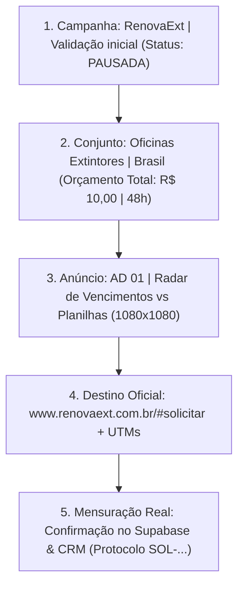

# 📢 GUIA OPERACIONAL — CAMPANHA META ADS & PUBLICAÇÃO RENOVAEXT

> **Status:** RASCUNHO / PAUSADA — NENHUM ANÚNCIO PUBLICADO • ZERO GASTO INICIADO  
> **Orçamento Total Máximo:** R$ 10,00 (Dez reais)  
> **Objetivo:** Validação comercial e captação das primeiras conversas com empresas de manutenção e recarga de extintores  

---

## 1. Estrutura da Campanha no Meta Ads (Gerenciador de Anúncios)



---

## 2. Configurações Exatas de Criação

### 2.1. Nível 1: Campanha
* **Nome da Campanha:** `RenovaExt | Validação inicial`
* **Categoria Especial de Anúncios:** Não selecionar nenhuma categoria (não envolve crédito, emprego, habitação nem política).
* **Objetivo da Campanha:** `Cadastros` (Leads) ou `Tráfego com foco na página de destino`.
* **Orçamento da Campanha Advantage (CBO):** Desativado (orçamento fixado no conjunto).
* **Status:** **PAUSADA (Draft / Rascunho)**.

### 2.2. Nível 2: Conjunto de Anúncios (Ad Set)
* **Nome do Conjunto:** `Oficinas Extintores | Brasil | Feed e Stories`
* **Local de Conversão:** `Site` (Direcionamento externo para a landing page).
* **Meta de Desempenho:** `Maximizar visualizações da página de destino` ou `Maximizar conversões`.
* **Orçamento e Programação (Regra Crítica do Piso da Meta em BRL):**
  * **Tipo de Orçamento:** `Orçamento Total` (Lifetime Budget).
  * **Valor Exato:** `R$ 10,00` (Dez reais).
  * **Data de Início:** D+1 às 08:00 (Horário de Brasília).
  * **Data de Término:** D+2 às 23:59 (Horário de Brasília) — *duração de ~40 horas*.
  > [!IMPORTANT]
  > **Verificação de Regra Meta:** A Meta exige um gasto diário mínimo de ~US$ 1,00/dia (~R$ 5,00 a R$ 6,00/dia). Configurando a campanha para um período de **2 dias** com Orçamento Total de R$ 10,00, a Meta aceita perfeitamente o valor total de R$ 10 sem exigir aumento de verba.
* **Público:**
  * **Localização:** Brasil (Todo o país, ou opcionalmente focado nos estados com maior concentração de oficinas: SP, MG, PR, RJ e RS).
  * **Idade:** 25 a 65+ anos.
  * **Gênero:** Todos.
  * **Idiomas:** Português (Brasil).
  * **Segmentação Detalhada (Interesses Específicos do Ramo):**
    * *Extintor de incêndio*
    * *Prevenção e combate a incêndio*
    * *Segurança contra incêndio*
    * *Engenharia de segurança do trabalho*
    * *Corpo de Bombeiros Militar*
  * **Posicionamentos:** Advantage+ (Automático: Feed do Instagram, Stories do Instagram, Feed do Facebook).

### 2.3. Nível 3: Anúncio (Ad Creative)
* **Nome do Anúncio:** `AD 01 | Radar de Vencimentos vs Planilhas`
* **Identidade do Anúncio:**
  * Página do Facebook: Página oficial da RenovaExt.
  * Conta do Instagram: `@renovaext` (ou vinculada à Página).
* **Formato:** Imagem única (Quadrado 1:1 — 1080×1080).
* **Mídia Recomendada:**
  * Imagem de alta definição combinando o logotipo e a prévia do Radar de Vencimentos:
    `public/brand/instagram/post-01-agenda-renovacoes-extintores.png` ou `public/captura-tela1-radar.png`.
* **Texto Principal (Copy Comercial Dirigida):**
```text
Sua empresa de manutenção de extintores ainda perde tempo caçando datas de vencimento em planilhas dispersas?

Clientes esquecidos significam renovações perdidas e retrabalho para sua equipe comercial.

O RenovaExt organiza toda a sua carteira em um só lugar:
✓ Importe planilhas de clientes e equipamentos em poucos cliques;
✓ Visualize na hora o que vence em 30, 60 e 90 dias e os registros em atraso;
✓ Emita propostas comerciais em PDF com seus próprios preços, sem complicação.

Sem promessas milagrosas. Uma rotina comercial simples, ágil e focada em renovações.

Toque no botão abaixo, explore a demonstração interativa e solicite o piloto de 30 dias.
```
* **Título:** `Agenda Comercial para Empresas de Extintores`
* **Descrição Opcional:** `Organize vencimentos e emita propostas em PDF.`
* **Botão de Chamada para Ação (CTA):** `Saiba mais` ou `Cadastre-se`.
* **URL de Destino Oficial com Parâmetros UTM:**
```url
https://www.renovaext.com.br/?utm_source=meta_ads&utm_medium=cpc&utm_campaign=validacao_inicial&utm_content=ad01_radar#solicitar
```
*(URL alternativa enquanto o DNS é propagado: `https://jefersond.github.io/renovaext-demo/?utm_source=meta_ads&utm_medium=cpc&utm_campaign=validacao_inicial&utm_content=ad01_radar#solicitar` ou `https://renovaext.pages.dev/?utm_source=meta_ads&utm_medium=cpc&utm_campaign=validacao_inicial&utm_content=ad01_radar#solicitar`)*.

---

## 3. Protocolo de Mensuração com Privacidade (Zero Rastreamento Invasivo)

1. **Clique NUNCA é Lead:**
   * O clique no anúncio é classificado tecnicamente como mero *tráfego*.
   * Um lead só é contabilizado quando o titular preenche e confirma os 7 campos no formulário `#solicitar`.
2. **Registro Auditável no Supabase e CRM:**
   * Quando o visitante envia o formulário, a função `submit_commercial_lead` grava o parâmetro `source_page` contendo as UTMs (`utm_source=meta_ads...`).
   * Um protocolo oficial único (`SOL-YYYYMMDD-XXXXXX`) é gerado e retornado na tela para o usuário.
   * O trigger `trg_sync_lead_to_crm_pipeline` cria automaticamente a linha de acompanhamento no pipeline CRM do PostgreSQL.
3. **Consulta de Resultados pelo Fundador:**
   * No terminal: `node tools/founder_leads_cli.mjs` (exibe imediatamente todos os interessados reais sem expor segredos).

---

## 4. Configuração DNS Exata para `renovaext.com.br` na Cloudflare

Para conectar o domínio à Cloudflare Pages preservando futuros registros de e-mail corporativo (`contato@renovaext.com.br`):

| Tipo | Nome | Conteúdo / Destino | Proxy Status | Finalidade |
|---|---|---|---|---|
| **CNAME** | `@` (raiz) | `renovaext.pages.dev` | **Proxied (Laranja)** | Aponta o domínio raiz `renovaext.com.br` via CNAME Flattening para o site |
| **CNAME** | `www` | `renovaext.pages.dev` | **Proxied (Laranja)** | Aponta `www.renovaext.com.br` para o site oficial |
| **CNAME** | `demo` | `renovaext.pages.dev` | **Proxied (Laranja)** | Subdomínio dedicado `demo.renovaext.com.br` |

### Preservação de E-mails Futuros (Zero Interferência):
* Não utilize registros coringa (`*`).
* Quando for ativar o e-mail (`contato@` e `suporte@`), basta adicionar os registros `MX` (ex: Zoho Mail, Google Workspace ou Cloudflare Email Routing) e `TXT` (SPF e DMARC). Os registros `CNAME` do site não interferem no fluxo de e-mails.

---

## 5. Checklist para o Fundador Iniciar as Vendas

- [x] Domínio `renovaext.com.br` registrado e ativo no Registro.br.
- [x] Repositório GitHub atualizado com build `npm run build` e saída `dist`.
- [x] Landing page comercial corporativa no ar (Full HD showcase, sem vídeo rejeitado).
- [x] Demonstração interativa fictícia com sandbox e trava de upload real.
- [x] Formulário integrado ao Supabase com anti-spam, RLS e conformidade LGPD.
- [x] Teste ponta a ponta com UTMs de Meta Ads validado com 100% de sucesso.
- [x] Campanha Meta Ads roteirizada em Rascunho/Pausada com teto de R$ 10,00.
- [ ] **Ação do Fundador 1:** Conectar `jefersond/renovaext-demo` no Cloudflare Pages (leva 2 minutos).
- [ ] **Ação do Fundador 2:** Apontar os 2 nameservers da Cloudflare no Registro.br.
- [ ] **Ação do Fundador 3:** Revisar a campanha Meta Ads e despausar no Gerenciador de Anúncios.
